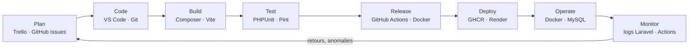
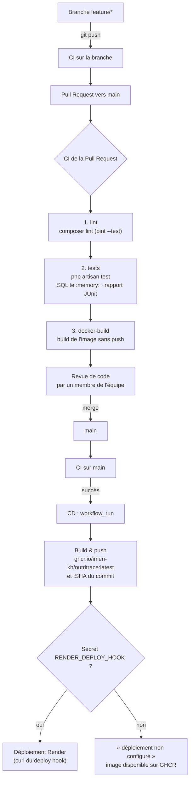

# DevOps — NutriTrace

Ce document décrit la chaîne DevOps du projet : du développement d'une fonctionnalité jusqu'à son
déploiement, avec les outils utilisés à chaque étape.

## 1. Le processus DevOps



| Étape | Ce que l'on fait | Outils |
|---|---|---|
| Plan | Découpage en fonctionnalités par module, suivi des tâches | Trello, GitHub Issues |
| Code | Une branche `feature/*` par fonctionnalité | VS Code, Git, GitHub |
| Build | Dépendances PHP et compilation des assets | Composer, Vite (Node 20) |
| Test | Tests automatisés et style du code | PHPUnit (SQLite en mémoire), Laravel Pint |
| Release | Pipeline CI à chaque push / Pull Request, image Docker | GitHub Actions, Docker |
| Deploy | Publication de l'image puis déploiement | GitHub Container Registry, Render (deploy hook) |
| Operate | Exécution de l'application et de sa base | Conteneur PHP 8.2 + Apache, MySQL 8 |
| Monitor | Suivi des erreurs et des exécutions | Logs Laravel (`stderr` en conteneur), historique GitHub Actions |

## 2. Le pipeline CI/CD



- **CI** ([.github/workflows/ci.yml](../.github/workflows/ci.yml)) : sur chaque push (`main`, `feature/**`) et chaque Pull Request vers `main`.
  Les trois jobs s'enchaînent (`needs`) : un échec arrête le pipeline et bloque la fusion.
- **CD** ([.github/workflows/cd.yml](../.github/workflows/cd.yml)) : déclenchée par la fin de la CI sur `main`,
  uniquement si elle a réussi et qu'il s'agit d'un push (fusion), jamais pour une Pull Request.
  Elle construit l'image à partir du commit exact validé par la CI.

## 3. Stratégie de branches

- `main` : branche stable, toujours déployable ; on n'y pousse jamais directement.
- `feature/<sujet>` (ex. `feature/tracabilite`, `feature/auth-avancee`, `feature/devops`) : une branche par fonctionnalité, créée depuis `main`.
- Fusion par **Pull Request** : CI verte obligatoire + relecture par un autre membre.
- Messages de commit en français, préfixés par le module : `Traçabilité : …`, `Gestion user : …`, `DevOps : …`.

Protection conseillée de `main` (Settings → Branches → Branch protection rules) : *Require a pull request before merging*
et *Require status checks to pass* avec les jobs `Qualité (Pint)`, `Tests (PHPUnit, SQLite en mémoire)` et `Construction de l'image Docker`.

## 4. Les tests automatisés

Les tests tournent sur **SQLite en mémoire** (voir `phpunit.xml`) : rapides, isolés, et sans aucun risque pour la base MySQL
de développement. `tests/TestCase.php` refuse de démarrer si la connexion n'est pas `sqlite` / `:memory:` (par exemple si la
configuration a été mise en cache), et `Http::preventStrayRequests()` interdit tout appel réseau réel : l'API Gemini est simulée avec `Http::fake`.

| Fichier | Tests | Ce qui est vérifié |
|---|---|---|
| `Feature/Auth/AuthentificationTest` | 10 | inscription (email de vérification envoyé, rôle Spatie), erreurs de validation, connexion / déconnexion, mauvais mot de passe, redirection sans connexion, email non vérifié renvoyé vers `verification.notice`, lien signé, 403 d'un producteur sur `/admin` |
| `Feature/Auth/ReinitialisationMotDePasseTest` | 6 | envoi du lien (`Notification::fake`), adresse inconnue, reset avec jeton valide, jeton invalide refusé, mot de passe trop faible |
| `Feature/Auth/DoubleAuthentificationTest` | 9 | QR code affiché, mot de passe exigé, clé chiffrée en base, confirmation par code TOTP (google2fa), challenge au login, code non rejouable, code de récupération à usage unique, désactivation |
| `Feature/Auth/RolesPermissionsTest` | 5 | rôle Spatie synchronisé avec `role` / `type_acteur`, producteur sans `gerer-categories`, admin avec toutes les permissions, middleware `permission:` |
| `Feature/Tracabilite/LotTest` | 11 | création d'un lot, erreurs de validation, produit d'un autre refusé, rappel sans motif refusé, étape antérieure à la production refusée, étape valide, type d'étape interdit, cloisonnement des lots entre producteurs, page publique `/tracabilite/{code}`, motif de rappel affiché, assistant : question vide → 422 |
| `Feature/Tracabilite/TracabiliteIATest` | 8 | histoire générée puis servie depuis le cache, échec 500 → page sans IA, analyse JSON entourée de ```json, bouton « Analyser » (succès / échec → anomalies déterministes seules), assistant (réponse et 503), aucun appel sans clé |
| `Feature/BilanEnvironnementalTest` | 15 | module Environnement (CRUD, validation, pages publiques) |
| `Feature/ReclamationTest` | 10 | module Réclamations (CRUD, droits, réponses, service d'analyse) |
| `Feature/ExampleTest` | 1 | la page d'accueil répond |
| `Unit/LotTransparenceTest` | 12 | `Lot::anomalies()` (vitesse > 120 km/h, chaîne du froid, seuil configurable, étapes manquantes) et `Lot::scoreTransparence()` |
| `Unit/DistanceHaversineTest` | 4 | distance de Haversine (valeurs de référence, symétrie) |
| `Unit/ExampleTest` | 1 | test d'exemple |

```bash
php artisan test                         # toute la suite
php artisan test tests/Feature/Auth      # un dossier
php artisan test --filter=DoubleAuth     # par nom
```

## 5. Qualité du code (Pint) : pourquoi une liste de fichiers

`pint.json` utilise le preset `laravel`. La CI lance `composer lint`, c'est-à-dire `pint --test` sur une **liste de fichiers
maîtrisés** (tests, services, contrôleurs et requests de la traçabilité et de la gestion user… — voir le script `lint` de
`composer.json`), et non sur tout le projet :

- un `pint` global reformaterait des centaines de lignes écrites par les autres membres, mélangées à leur travail en cours :
  des conflits de fusion garantis et des Pull Requests illisibles ;
- `pint --test` sur tout le projet échouerait aujourd'hui sur du code qui n'est pas le nôtre, et la CI resterait rouge ;
- avec une liste maîtrisée, la CI est verte et **bloque toute régression de style** sur ces fichiers.

La liste est destinée à grandir : quand un membre a formaté son module (`vendor/bin/pint app/…`), il ajoute ses dossiers
aux scripts `lint` et `lint:fix` de `composer.json`.

## 6. Docker

L'image est construite en trois étapes ([Dockerfile](../Dockerfile)) : `node:20` (Vite), `composer:2` (dépendances
`--no-dev`), puis `php:8.2-apache` (extensions `pdo_mysql`, `gd`, `zip`, `bcmath`, `intl`, `opcache`, `mod_rewrite`,
racine web sur `public/`). Ni `.env`, ni `node_modules`, ni les certificats locaux n'entrent dans l'image (`.dockerignore`).
Au démarrage, [docker/entrypoint.sh](../docker/entrypoint.sh) attend MySQL, lance les migrations, crée le lien `storage`
et met en cache configuration, routes et vues. Il respecte la variable `PORT` imposée par Render.

```bash
docker compose up -d --build                    # app :8000, phpMyAdmin :8080, Mailpit :8025
SEED_DATABASE=true docker compose up -d         # avec les données de démonstration
docker compose logs -f app                      # logs de l'application
docker compose exec app php artisan migrate:status
docker compose down                             # arrêt (ajouter -v pour effacer la base)

docker build -t nutritrace .                    # image seule
docker run --rm -p 8000:80 -e APP_KEY=base64:… -e DB_HOST=… -e DB_DATABASE=… -e DB_USERNAME=… -e DB_PASSWORD=… nutritrace
docker pull ghcr.io/imen-kh/nutritrace:latest   # image publiée par la CD
```

## 7. Secrets et configuration

Aucun secret n'est écrit dans le code ni dans les workflows. Le `.env` local n'est jamais commité, jamais copié dans l'image,
et la CI construit le sien à partir de `.env.example`.

| Secret / variable | Où | Rôle |
|---|---|---|
| `GITHUB_TOKEN` | fourni automatiquement par GitHub | connexion à `ghcr.io` pour publier l'image (permission `packages: write`) |
| `RENDER_DEPLOY_HOOK` | GitHub → Settings → Secrets and variables → Actions (facultatif) | URL du deploy hook Render ; absent = la CD s'arrête après la publication de l'image |
| `APP_KEY` | variables d'environnement de l'hébergeur | clé de chiffrement Laravel (`php artisan key:generate --show`) |
| `DB_HOST`, `DB_PORT`, `DB_DATABASE`, `DB_USERNAME`, `DB_PASSWORD`, `MYSQL_ATTR_SSL_CA` | hébergeur | base MySQL de production |
| `MAIL_*` | hébergeur | serveur SMTP (Mailtrap en test, Mailpit avec Docker) |
| `GEMINI_API_KEY` | hébergeur | IA du module Traçabilité (vide = fonctionnement sans IA) |

Sur Render : créer un *Web Service* de type **Docker** à partir de l'image `ghcr.io/imen-kh/nutritrace:latest`,
renseigner les variables ci-dessus, puis copier son *Deploy Hook* dans le secret GitHub `RENDER_DEPLOY_HOOK`.
